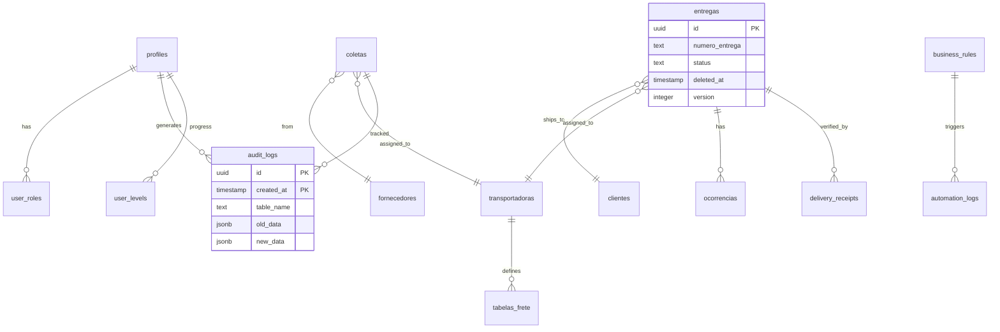

# 🗺️ Diagrama de Entidade-Relacionamento (ER) — LogiFlow

## 📝 Notas de Arquitetura

1.  **Partitioning:** A tabela `audit_logs` é particionada mensalmente por `created_at`.
2.  **Soft Delete:** Campos `deleted_at` em tabelas operacionais impedem a perda de dados acidental.
3.  **Concurrency:** O campo `version` em `entregas` e `coletas` permite Optimistic Locking via triggers.
4.  **Security:** Todas as tabelas são blindadas via RLS nativo do Supabase.
